# XBIOS

MSX1 · MSX2 · MSX2+ · turbo R 용 시스템 ROM(BIOS)입니다. MSX-BASIC 대신 파이썬(XPY)이 들어 있습니다.

A system ROM (BIOS) for MSX1, MSX2, MSX2+ and turbo R, with Python (XPY) in place of MSX-BASIC.

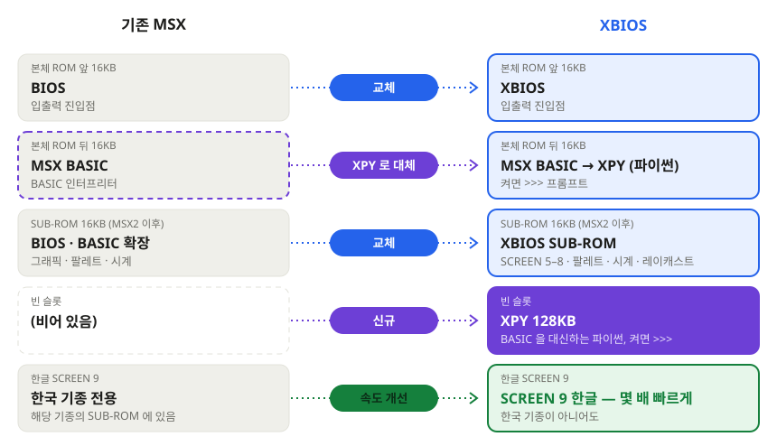

## 구성 / Editions

| 구성 | 전원을 켜면 | 파일 |
|---|---|---|
| XBIOS | 카트리지나 디스크를 실행. 없으면 시작 화면 | 본체 ROM 32KB (MSX2 이후 + SUB-ROM 16KB) |
| XBIOS + XPY | `XPY version 1.0` 과 `>>>` 프롬프트 | 위 + `xpybank.rom` 128KB |
| XBIOS + XPY + 디스크 | 같은 프롬프트. `fs.load("NAME.PY")` 로 디스크의 프로그램 실행 | 위 + `xdisk.rom` 16KB |

| Edition | At power-on | Files |
|---|---|---|
| XBIOS | runs a cartridge or disk; a start screen if there is none | 32 KB main ROM (+ 16 KB SUB-ROM from MSX2 on) |
| XBIOS + XPY | `XPY version 1.0` and a `>>>` prompt | the above + `xpybank.rom`, 128 KB |
| XBIOS + XPY + disk | the same prompt; `fs.load("NAME.PY")` runs a program from disk | the above + `xdisk.rom`, 16 KB |

XPY 는 RAM 64KB 가 필요합니다. / XPY needs 64 KB of RAM.

## 현재 상태 / Status

- 디스크 부팅, MSX-DOS 1 BDOS 함수 37개
- PSG, PLAY, MSX-MUSIC
- MSX2 · MSX2+ · turbo R: SCREEN 4–9, 매퍼, 시계, 팔레트, R800, PCM
- SCREEN 9 한글 화면과 두벌식 입력 (VRAM 128KB 인 MSX2 이후 기종)
- 확장 칩: GFX9000, MoonSound, MSX-AUDIO, SCC/SCC+, 2nd PSG, MSX-MIDI, SN76489, Yamaha SFG, FAC MIDI
- MSX2 이후는 에뮬레이터에서만 시험했습니다.

---

- Disk boot, all 37 MSX-DOS 1 BDOS functions
- PSG, PLAY, MSX-MUSIC
- MSX2 · MSX2+ · turbo R: SCREEN 4–9, memory mapper, clock, palette, R800, PCM
- SCREEN 9 hangul screen and input (MSX2 or later with 128 KB VRAM)
- Expansion chips: GFX9000, MoonSound, MSX-AUDIO, SCC/SCC+, 2nd PSG, MSX-MIDI, SN76489, Yamaha SFG, FAC MIDI
- MSX2 and later have been tested in emulators only.

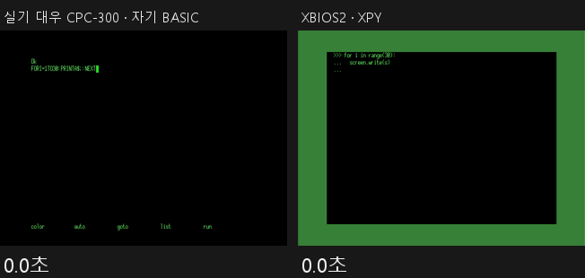

같은 한글 출력이 대우 CPC-300 보다 몇 배 빠릅니다.
The same hangul output runs several times faster than on a Daewoo CPC-300.

## 예제 화면 / Screenshots

`dist/examples.dsk` 의 XPY 프로그램입니다. `fs.load("XWAVE.PY")` 처럼 실행합니다.
XPY programs on `dist/examples.dsk`, run with `fs.load("XWAVE.PY")`.

<table>
<tr><td align="center" width="50%"> <b>XWAVE</b> · turbo R 플라스마 · 노을 · 장미 곡선 그래픽 데모 Plasma, sunset and rose-curve demo</td><td align="center" width="50%">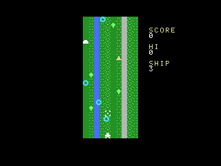 <b>MZEBI</b> · MSX2 세로 스크롤 슈팅 Vertical shooter</td></tr>
<tr><td align="center" width="50%">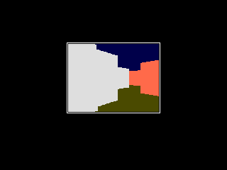 <b>XMAZE</b> · turbo R 1인칭 3D 미로 (BIOS 레이캐스트) First-person 3D maze (BIOS raycaster)</td><td align="center" width="50%">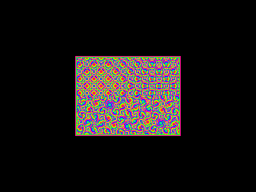 <b>XROTO</b> · turbo R 회전·확대 데모 Rotozoom demo</td></tr>
<tr><td align="center" width="50%">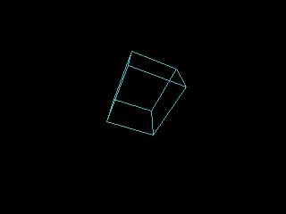 <b>XPOLY</b> · turbo R 도형과 큐브 3D 회전 Rotating shapes and cube in 3D</td><td align="center" width="50%">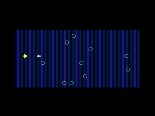 <b>XSHOT</b> · turbo R 가로 스크롤 슈팅 Horizontal shooter</td></tr>
<tr><td align="center" width="50%"> <b>MANDEL</b> · MSX2 만델브로 집합 Mandelbrot set</td><td align="center" width="50%"> <b>BALLS</b> · MSX2 스프라이트 32개 32 bouncing sprites</td></tr>
<tr><td align="center" width="50%">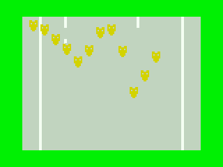 <b>XROAD</b> · MSX1 마주 오는 차를 피하는 게임 Dodge the oncoming cars</td><td align="center" width="50%">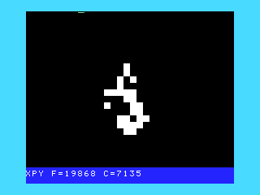 <b>LIFE</b> · MSX2 라이프 게임 Conway's Life</td></tr>
<tr><td align="center" width="50%">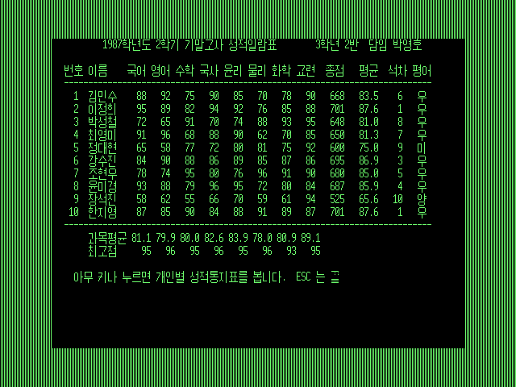 <b>SUNGJUK</b> · MSX2 SCREEN 9 한글 성적처리 (1980년대 고교 성적일람표) Grade sheet on the SCREEN 9 hangul screen</td><td align="center" width="50%">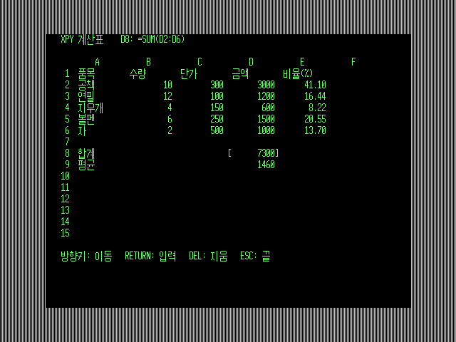 <b>SHEET</b> · MSX2 SCREEN 9 한글 계산표 (수식 · SUM) Spreadsheet with formulas</td></tr>
</table>

## 설치 / Install

- 에뮬레이터 설치 안내: [`docs/install.html`](https://bearslee77-collab.github.io/xbios/install.html)
- 예제 화면: [`docs/index.html`](https://bearslee77-collab.github.io/xbios/)
- `dist/install.bat` 을 실행하면 이 PC 의 openMSX · blueMSX 에 기계 구성을 등록합니다.
- openMSX: `dist/openmsx/` · blueMSX: `dist/bluemsx/`
- MSX1 실기: `dist/xbios_1.rom` ([`dist/README.md`](dist/README.md))
- 체크섬: `dist/CHECKSUMS.txt`

## 예제 / Examples

- `demo/pydemo.rom` — XPY 데모 카트리지 (MSX2 이후)
- `dist/examples.dsk` — 예제 디스크. `fs.dir()` 로 목록, `fs.load("XMAZE.PY")` 로 실행
- `examples/` — 예제 소스. `.BAS` 는 같은 알고리즘의 MSX BASIC 판
- XPY 명령어: [`docs/xpy.html`](https://bearslee77-collab.github.io/xbios/xpy.html)

## 라이선스 / Licence

© 2026 GHOST · [CC BY-NC-ND 4.0](https://creativecommons.org/licenses/by-nc-nd/4.0/)
